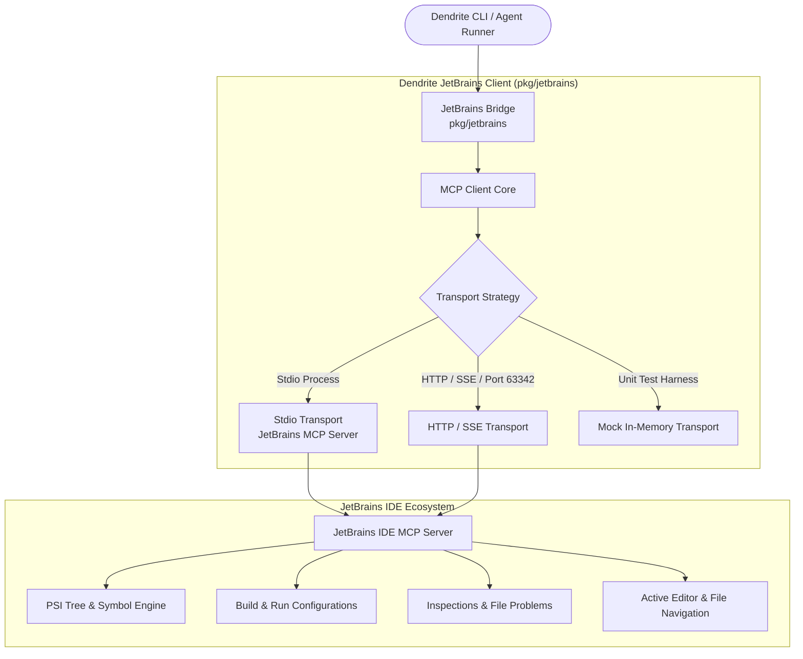

<!-- Imported from Dendrite docs/features/FEAT-014-jetbrains-ide-mcp-integration.md @ 69ea048 on 2026-10-18. Source of truth for this repo's scope; keep in sync with the Dendrite copy until the extraction umbrella lands. -->

---
id: FEAT-014
title: JetBrains IDE MCP Integration & Communication Bridge
status: approved
plane_epic: PROJ-E-14
dependencies: [FEAT-003, FEAT-004, FEAT-013]
repository: dendrite
tags: [jetbrains, mcp, model-context-protocol, ide-integration, goland, json-rpc]
---

# FEAT-014: JetBrains IDE MCP Integration & Communication Bridge

## 1. User Story & Business Objective

As a software engineer and AI orchestrator using Dendrite, I need Dendrite to natively communicate with JetBrains IDEs (GoLand, IntelliJ IDEA, PyCharm, RustRover, WebStorm, CLion) through the **Model Context Protocol (MCP)** and IDE automation endpoints. This enables Dendrite autonomous agents to discover IDE capabilities, trigger background compilations and run configurations, query file diagnostics and lint problems, resolve code symbols with IDE PSI precision, and open/navigate active editor tabs directly from the CLI or autonomous agent harnesses.

---

## 2. Technical Boundaries & Protocol Architecture

JetBrains IDEs support external communication via:
1. **Model Context Protocol (MCP)**:
   - JSON-RPC 2.0 communication over standard input/output (stdio) or Server-Sent Events (SSE) / HTTP.
   - MCP Protocol Lifecycle:
     - `initialize`: Capability negotiation and version agreement (`2024-11-05` / `latest`).
     - `notifications/initialized`: Notification acknowledging handshake completion.
     - `tools/list`: Dynamic discovery of IDE tools (`lint_files`, `get_file_problems`, `search_symbol`, `get_symbol_info`, `open_file_in_editor`, `execute_run_configuration`, `build_project`, `execute_terminal_command`, `generate_psi_tree`).
     - `tools/call`: Execution of IDE tools with JSON arguments.
     - `resources/list` & `resources/read`: Retrieval of IDE logs, schemas, and virtual file contents.
     - `ping`: Keepalive and health latency monitoring.
2. **JetBrains Built-in REST API**:
   - HTTP endpoint on port `63342` (default JetBrains internal web server).
   - Endpoints for IDE status, file navigation, and project metadata.

---

## 3. Component Design (`pkg/jetbrains`)

1. **Protocol & Models (`pkg/jetbrains/types.go`)**:
   - Standard JSON-RPC 2.0 requests, responses, and error envelopes.
   - MCP schema types: `InitializeRequest`, `InitializeResult`, `Tool`, `ToolCallRequest`, `ToolCallResult`, `ContentItem`.
   - Typed error definitions: `ErrNotConnected`, `ErrToolNotFound`, `ErrExecutionFailed`, `ErrInvalidResponse`.

2. **Pluggable Transport (`pkg/jetbrains/transport.go`)**:
   - `Transport` interface: `Send(ctx, req) (*JSONRPCResponse, error)` and `Close() error`.
   - `StdioTransport`: Spawns or attaches to an MCP server process over standard streams.
   - `HTTPTransport`: Connects to JetBrains HTTP/SSE or JSON-RPC endpoints.
   - `MockTransport`: Thread-safe, deterministic transport for testing with pre-seeded tools and responses.

3. **MCP Client Core (`pkg/jetbrains/client.go`)**:
   - Coordinates session lifecycle, `initialize` handshake, request ID sequencing, timeout contexts, and error mapping.
   - Methods: `Connect(ctx)`, `ListTools(ctx)`, `CallTool(ctx, name, args)`, `Ping(ctx)`.

4. **High-Level JetBrains Bridge (`pkg/jetbrains/bridge.go`)**:
   - Provides strongly-typed IDE methods:
     - `OpenFile(ctx, filePath, line, column)`: opens and highlights files in the active JetBrains editor.
     - `GetFileProblems(ctx, filePath)`: queries IDE inspections and lint diagnostics.
     - `SearchSymbol(ctx, query)`: locates symbols across the project index.
     - `BuildProject(ctx)`: triggers project compilation in the IDE.
     - `ExecuteRunConfiguration(ctx, configName)`: executes IDE run/test configurations.
     - `LintFiles(ctx, files)`: invokes IDE linting on specified files.

5. **IDE Toolset Configuration Routine (`pkg/jetbrains/setup.go`)**:
   - `SetupJetBrainsToolset(opts)`: Configures project-level (`.ai/mcp/mcp.json`) and global (`~/.ai/mcp/mcp.json`) MCP server definitions.
   - Generates 6 standard JetBrains Run Configurations (`.idea/runConfigurations/`) for MCP server, Aider, Antigravity, Web UI, and diagnostics.
   - Generates JetBrains External Tools (`.idea/tools/External_Tools.xml`) for right-click context menu integration.

6. **CLI Subcommand Ergonomics (`cmd/dendrite`, `main.go`)**:
   - `dendrite jetbrains setup [--project-only|--global-only]`: automates full JetBrains MCP toolset configuration.
   - `dendrite jetbrains probe`: checks IDE connectivity and lists discovered tools.
   - `dendrite jetbrains open <file> [--line N]`: opens target file in JetBrains editor.
   - `dendrite jetbrains problems <file>`: queries IDE diagnostics for a file.
   - `dendrite jetbrains call <tool> [args]`: invokes any JetBrains MCP tool directly.

---

## 4. Acceptance Criteria & Verification Matrix

- [x] **AC-1 (Handshake & Discovery)**: Client successfully performs JSON-RPC 2.0 `initialize` handshake and dynamically retrieves available tools via `tools/list`.
- [x] **AC-2 (Tool Execution & Call Dispatch)**: Client safely dispatches `tools/call` with arbitrary arguments and handles text, error, and structured output payloads.
- [x] **AC-3 (Typed IDE Bridge Helpers)**: Bridge methods (`OpenFile`, `GetFileProblems`, `SearchSymbol`, `BuildProject`, `ExecuteRunConfiguration`) provide ergonomic wrappers with validation.
- [x] **AC-4 (Transport Resiliency)**: Gracefully handles connection drops, timeout curfews, invalid payloads, and tool-not-found errors without panics.
- [x] **AC-5 (Complexity & Coverage)**: Unit test suite achieves $\ge 85\%$ statement coverage and adheres to cyclomatic complexity $\le 10$ per function.
