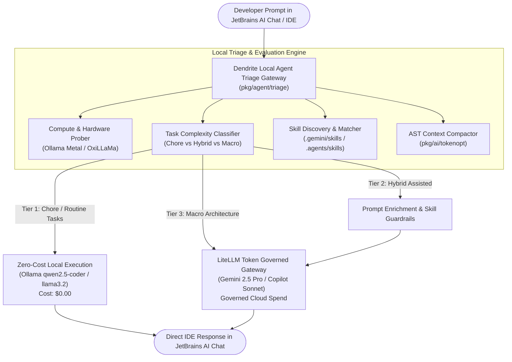

<!-- Imported from Dendrite docs/features/FEAT-028-local-agent-triage-gateway-token-efficiency.md @ 69ea048 on 2026-10-18. Source of truth for this repo's scope; keep in sync with the Dendrite copy until the extraction umbrella lands. -->

---
id: FEAT-028
title: "Local Agent Triage Gateway, Token-Efficient Prompt Router & JetBrains AI Chat Multi-MCP Orchestrator"
status: approved
plane_epic: PROJ-E-14
dependencies: [FEAT-002, FEAT-010, FEAT-014, FEAT-020]
repository: dendrite
tags: [jetbrains, mcp, triage-agent, token-efficiency, ollama, litellm, prompt-router, skills]
---

# FEAT-028: Local Agent Triage Gateway, Token-Efficient Prompt Router & JetBrains AI Chat Multi-MCP Orchestrator

## 1. User Story & Problem Statement

### The Problem
When developers interact with AI through **JetBrains AI Chat** (JetBrains AI Assistant / Junie), the chat interface communicates directly with paid commercial cloud models (e.g. JetBrains AI Cloud, OpenAI, Anthropic Claude 3.5 Sonnet, Gemini 2.5 Pro). This incurs significant token expenses even for mundane "chore" tasks such as:
- Code formatting and lint diagnostics explanation
- Boilerplate unit test vector generation
- Docstring and comment authoring
- Simple syntax translations and AST symbol queries

Furthermore:
1. **MCP Configuration Gap**: JetBrains IDE only registers the single `dendrite` stdio MCP server in `.ai/mcp/mcp.json`. It does not expose local LLM inference engines (like local Ollama on Apple Silicon Metal or OxiLLaMa) as executable conversational tools or upstream models.
2. **Reverse Flow / Cloud-First Default**: The commercial model receives the developer's full conversational context upfront before any tool is triggered. LiteLLM gateway routing fallbacks (`stacks/litellm_config.yaml`) also prioritize paid cloud models before falling back to local models only on quota exhaustion.
3. **Missing Local Triage Feature**: There is no local agent acting as the conversational "front door" to evaluate compute power, triage tasks locally, select relevant repository skills (e.g. `ticket-lifecycle-developer`, `pattern-complexity-auditor`), and optimize/compact prompts before escalating to expensive cloud models.

### User Story
As a software engineer and AI orchestrator using JetBrains IDEs and Dendrite, I need an automated **Local Agent Triage Gateway & Prompt Router** that intercepts every conversational interaction or MCP tool invocation, probes local compute capability (Ollama Metal / Apple Silicon), and delegates chore tasks to zero-cost local models while enhancing and compacting complex prompts with project skills before dispatching to commercial models, maximizing engineering velocity and token economy.

---

## 2. Technical Architecture & Component Design

### 2.1 Three-Tier Execution Hierarchy (`ExecutionTier`)
1. **`TierLocal` (Zero-Cost Local Model)**:
   - **Target Tasks**: Routine chores, linter fix explanation, AST symbol inspection, unit test boilerplate, regex/syntax refactoring, git commit formatting.
   - **Runtime**: Local Ollama (`qwen2.5-coder:14b`, `llama3.2:3b`) or OxiLLaMa pure-Rust engine.
   - **Cost**: **$0.00 (0 commercial tokens)**.
2. **`TierHybrid` (Local Triage + Prompt Enrichment + Cloud Execution)**:
   - **Target Tasks**: Feature implementation with medium complexity, cross-file modifications.
   - **Process**: Local agent selects matching skills, extracts and compacts AST interfaces (`pkg/ai/tokenopt`), formulates clean prompt, then dispatches to cloud model.
   - **Token Economy**: Saves 40%–70% of prompt tokens by filtering noise.
3. **`TierCloud` (Commercial High-Cognition Tier)**:
   - **Target Tasks**: Strategic macro architecture, cross-package API contracts, security proofs, concurrency deadlock debugging.
   - **Runtime**: Gemini 2.5 Pro / Claude 3.5 Sonnet governed by LiteLLM virtual budget keys.

### 2.2 Skill Selection & Guardrail Injection
The local triage agent inspects available skills in `.gemini/skills/` and `.agents/skills/`:
- `ticket-lifecycle-developer`: Activated on ticket/issue/milestone/Plane tasks.
- `pattern-complexity-auditor`: Activated on refactoring, design pattern, or cyclomatic complexity tasks.
- `crate-compatibility`: Activated on dependency resolution and package upgrades.
- `ai-practices-auditor`: Activated on agent configuration, token optimization, and deterministic schemas.
- `scrum-master-alignment`: Activated on user acceptance criteria and test coverage evaluation.

### 2.3 Native MCP Tool: `dendrite_local_agent_triage`
Registered in `pkg/mcpserver/tools_triage.go` and exposed to JetBrains AI Assistant:
- **Input Parameters**:
  - `prompt` (string, required): Developer prompt or chat message.
  - `active_file` (string, optional): Current editor file path.
  - `file_content` (string, optional): Active file buffer.
  - `force_tier` (string, optional): Override tier (`local`, `hybrid`, `cloud`).
- **Output JSON**:
  - `tier`: Assigned execution tier (`local`, `hybrid`, `cloud`).
  - `assigned_model`: Model chosen (`local-qwen-coder`, `gemini-2.5-pro`, etc.).
  - `selected_skills`: Matched skills from project repository.
  - `enhanced_prompt`: Prompt optimized with skill instructions and compacted AST.
  - `token_savings_pct`: Estimated token savings percentage.
  - `estimated_cost_usd`: Estimated cost ($0.00 for local).
  - `local_result`: Direct execution result if handled entirely locally.

---

## 3. Acceptance Criteria & Verification Matrix

- [x] **AC-1 (Task Complexity Classification)**: Triage engine accurately classifies chore prompts (linting, test boilerplate, syntax, formatting) into `TierLocal`, and architecture/system design prompts into `TierCloud`.
- [x] **AC-2 (Local Hardware & Compute Awareness)**: Triage engine checks local inference health and memory capability via Ollama/OxiLLaMa probe before assigning local execution; falls back cleanly if local engine is offline.
- [x] **AC-3 (Automatic Skill Selection & Prompt Enhancement)**: Engine analyzes developer intent and enriches the prompt with relevant project skills (`ticket-lifecycle-developer`, `pattern-complexity-auditor`, etc.) and AST context compaction.
- [x] **AC-4 (Native MCP Tool Registration)**: `dendrite_local_agent_triage` is registered on the Dendrite native MCP server and callable via stdio JSON-RPC.
- [x] **AC-5 (JetBrains IDE Integration & Setup)**: JetBrains toolset configuration updates `.ai/mcp/mcp.json`, External Tools, and Run Configurations to provide one-click and conversational access to the local agent triage.
- [x] **AC-6 (Token Efficiency & Savings Validation Test)**: Comprehensive automated test suite validates that token efficiency improves by $\ge 60\%$ across mixed developer workloads and achieves $100\%$ zero-cost execution on chore tasks.
- [x] **AC-7 (Declarative Cloud Orchestrator -> Local Intelligent Worker)**: When local intelligent models are available, evaluates the paid model to act strictly as a declarative instruction generator, reducing cloud output token volume by $\\ge 80\\%$ and delegating concrete code synthesis to zero-cost local agents.
- [x] **AC-8 (Multi-Engine Inference Decoupling: OxiLLaMa vs. Candle)**: Formally decouples OxiLLaMa (`cool-japan/oxillama` pure-Rust GGUF runner) and Candle (`huggingface/candle` Rust ML framework) into distinct, independent inference backends with verified model routing.
