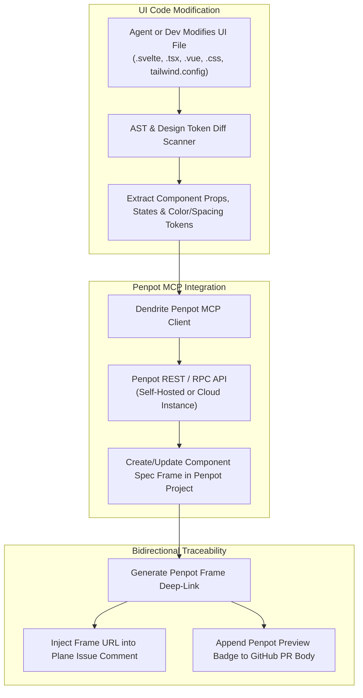

<!-- Imported from Dendrite docs/features/FEAT-037-penpot-ui-documentation-mcp-integration.md @ 69ea048 on 2026-10-18. Source of truth for this repo's scope; keep in sync with the Dendrite copy until the extraction umbrella lands. -->

---
id: FEAT-037
title: "Bidirectional Penpot UI Documentation & MCP Environment Integration"
status: approved
plane_epic: PROJ-E-16
dependencies: [FEAT-009, FEAT-014, FEAT-016, FEAT-035]
repository: dendrite
tags: [penpot, mcp, ui-documentation, design-tokens, plane-integration, svelte, tailwind]
---

# FEAT-037: Bidirectional Penpot UI Documentation & MCP Environment Integration

## 1. Executive Summary & Problem Statement

### The Problem
When frontend developers and autonomous agents modify UI components (`.svelte`, `.tsx`, `.vue`, CSS, Tailwind tokens), UI drift occurs silently. Visual changes are implemented in code without updating design mockups, components, and token hierarchies in the design workspace. Designers and reviewers are left guessing how code-level modifications affect design specifications, and there is no automated traceability linking UI code commits to design frames in Penpot.

### User Story & Architectural Pillars
As a full-stack engineer and UI designer, I need Dendrite to monitor UI file changes (`.svelte`, `.tsx`, `.jsx`, `.vue`, `.css`, Tailwind configurations), generate structured documentation frames in Penpot detailing component states and token diffs, and inject bidirectional deep-links into Plane tickets and GitHub PR comments so designers and developers can review and refine changes in real time.



---

## 2. Technical Architecture & Idiomatic Design Patterns

### 2.1 File Mutation Watcher & Token Diff Engine
When a story branch touches frontend assets:
- **Component Parser**: Extracts exported props, slots/children, Tailwind classes, and state variants.
- **Token Diff Synthesizer**: Compares CSS variables and design tokens against previous git commit baseline.
- **Penpot MCP Server**: Communicates via standard JSON-RPC 2.0 with the Penpot MCP adapter to draw or update design specification frames with rendered property tables.

### 2.2 Plane & GitHub Deep-Linking
Each generated frame generates a deterministic URL: `https://penpot.internal/#/workspace/{team_id}/{project_id}?page-id={page_id}&frame-id={frame_id}`.
Dendrite posts a formatted markdown comment to the associated Plane issue (`dendrite ticket update` or Plane REST API):
```markdown
### 🎨 Penpot UI Documentation Auto-Sync
- **Component**: `Button.svelte` (Story `UI-204`)
- **Tokens Updated**: `bg-primary-600`, `rounded-xl`, `padding: 12px 24px`
- **Penpot Specification**: [View Design Frame in Penpot](https://penpot.internal/#/workspace/...)
```

---

## 3. Behavioral Scenarios (Gherkin)

### Scenario 3A: Automatic Penpot Documentation Generation on UI Modification
- **Given** an active development session where the agent or developer modifies `Button.svelte` under ticket `UI-204`
- **When** the story implementation reaches the review or PR stage
- **Then** Dendrite invokes the Penpot MCP tool to document the updated token/component properties in Penpot, creating a dedicated component review frame.

### Scenario 3B: Bidirectional Traceability & Ticket Comment Deep-Linking
- **Given** the Penpot component frame has been successfully synthesized
- **When** the agent opens a pull request or updates ticket `UI-204` in Plane
- **Then** Dendrite embeds the Penpot frame deep-link into the Plane issue comment and the PR description for visual sign-off.

---

## 4. Acceptance Criteria & Definition of Done

- [ ] **AC-1 (UI Mutation Hook)**: Detects modifications across Svelte, React, Vue, CSS, and Tailwind files during story execution.
- [ ] **AC-2 (Penpot MCP Documentation)**: Synthesizes structured component states and token diffs in Penpot via MCP or REST API.
- [ ] **AC-3 (Bidirectional Traceability)**: Automatically links Penpot frames to Plane tickets and GitHub pull requests.
- [ ] **AC-4 (DoD & Complexity Thresholds)**: Mocked and live Penpot integration tests; cyclomatic complexity $\le 15$; cognitive complexity $\le 20$; coverage $\ge 85\%$.
