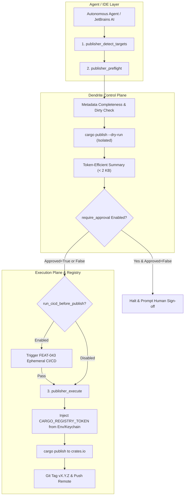

<!-- Imported from Dendrite docs/features/FEAT-042-artifact-package-publisher-mcp.md @ 69ea048 on 2026-10-18. Source of truth for this repo's scope; keep in sync with the Dendrite copy until the extraction umbrella lands. -->

---
id: FEAT-042
title: "Artifact & Package Publisher MCP Service & Registry Governance"
status: approved
plane_epic: PROJ-E-17
dependencies: [FEAT-013, FEAT-025, FEAT-034, FEAT-041]
repository: dendrite
tags: [mcp, publisher, cargo, crates-io, dry-run, secret-isolation, git-tag, governance]
---

# FEAT-042: Artifact & Package Publisher MCP Service & Registry Governance

## 1. Executive Summary & Problem Statement

### The Problem
Autonomous coding agents (such as Aider, OpenHands, and Google Antigravity / AGY) and software engineers developing polyglot systems frequently need to publish verified packages, library crates, or release artifacts to upstream registries. However, performing registry publishing autonomously introduces critical architectural and operational hazards:
1. **Secret Leakage into LLM Context**: Passing authentication tokens (`CARGO_REGISTRY_TOKEN`, npm tokens, PyPI API tokens) into agent prompts exposes high-privilege credentials to cloud inference providers and logs.
2. **Accidental Live Mutation Without Pre-Flight**: Agents can attempt to publish dirty working trees, missing metadata fields, or existing SemVer tags, causing irreversible registry failures or corrupted releases.
3. **Workspace Topological Ordering Failures**: Multi-crate Cargo workspaces require leaf/dependent crates to be published only after core dependencies are indexed by `crates.io`. Publishing out of order causes hard compilation rejections upstream.
4. **Lack of Human Governance**: Completely unconstrained agents might push broken or unauthorized releases to public registries without an explicit verification and human approval gate.

### Architectural Pillars & Solution
FEAT-042 introduces a bounded, token-efficient **Model Context Protocol (MCP) Service** (`pkg/mcp/publisher` / `internal/mcp/publisher`) and execution routine governing the package publication lifecycle:
1. **Pluggable Registry Adapter Interface (`PublisherAdapter`)**: Built-in support for Rust crates (`crates.io` via `cargo publish`) with an extensible contract for `npm`, `pypi`, `oci/docker`, and `github_release`. Computes topological dependency graphs for multi-crate Cargo workspaces with configurable index propagation delays.
2. **Pre-Flight Validation & Dry-Run Gate (`publisher_preflight`)**: Enforces clean Git working trees, validates `Cargo.toml` completeness, checks upstream registry SemVer availability, runs `cargo publish --dry-run`, and returns compact structured summaries.
3. **Secret Isolation on Execution Plane**: Registry tokens are injected strictly at the child process execution boundary on the Execution Plane. Raw credentials never enter the LLM prompt context.
4. **Interactive Approval Policy (`require_approval`)**: Mandates human approval flag (`approved = true`) before live registry mutation.
5. **Post-Publish Lifecycle & CI/CD Verification**: Creates annotated Git tags (`vX.Y.Z`) on successful push and optionally triggers Dendrite's ephemeral CI/CD routine (`FEAT-043`) before proceeding.



---

## 2. Technical Architecture & Idiomatic Design Patterns

### 2.1 Pluggable Adapter Interface (`PublisherAdapter`)
The publisher subsystem defines an extensible Go interface ensuring uniform behavior across package registries:

```go
type PublisherAdapter interface {
    DetectPackages(ctx context.Context, workspacePath string) ([]PackageTarget, error)
    Preflight(ctx context.Context, target PackageTarget, opts PreflightOptions) (*PreflightResult, error)
    Publish(ctx context.Context, target PackageTarget, opts PublishOptions) (*PublishResult, error)
}
```

The primary implementation is `CratePublisher`. For multi-crate workspaces, it inspects `Cargo.lock` and workspace `Cargo.toml` manifests, resolves the Directed Acyclic Graph (DAG) of local path dependencies, and computes a topological sort:
$$\text{Publish Order} = \text{TopologicalSort}(G_{\text{workspace}})$$
Between successive crate publications, the adapter injects `workspace_publish_delay_sec` (default: 15s) to allow `crates.io` index propagation.

### 2.2 Typestate Pattern for Publication Lifecycle
To guarantee that a live push cannot be executed without passing preflight and obtaining approval, the publisher implements the **Typestate Pattern**:
- `Publication<Unverified>`: Workspace scanned, metadata unverified.
- `Publication<PreflightPassed>`: Dry-run and SemVer availability verified.
- `Publication<Approved>`: Human or cryptographic token approval attached.
- `Publication<Published>`: Published upstream, Git tag annotated.

In Go, this is enforced through immutable state tokens passed between methods, preventing invalid lifecycle bypasses.

### 2.3 Secret Isolation & Environment Injection
Credentials (such as `CARGO_REGISTRY_TOKEN`) are never accepted as MCP tool arguments or returned in tool results. Instead:
1. The Control Plane references `token_env_var` configured in `dendrite.toml` (e.g. `"CARGO_REGISTRY_TOKEN"`).
2. The Execution Plane resolves the token from its local environment or system keychain.
3. The token is injected directly into `cmd.Env` of the child `cargo` process.

### 2.4 Token-Efficient Log Bounding
Verbose compiler outputs during `--dry-run` or packaging are bounded using a tailing algorithm:
- Outputs $\le 2048$ bytes are preserved verbatim.
- Outputs $> 2048$ bytes are truncated with prefix `...[truncated]...\n`, retaining the last 2048 bytes of high-signal compiler diagnostics.

---

## 3. Configuration Specification (`dendrite.toml`)

```toml
# ============================================================================
# MCP SERVICE: ARTIFACT & PACKAGE PUBLISHER
# ============================================================================
[mcp.publisher]
enabled = true
default_ecosystem = "cargo"
require_approval = true          # Require human/CLI sign-off before live registry push
enforce_clean_worktree = true    # Block publishing if uncommitted changes exist
run_cicd_before_publish = true   # Automatically invoke the CI/CD routine before live publish
auto_tag_release = true          # Tag vX.Y.Z on successful publish

[mcp.publisher.cargo]
registry = "crates-io"
token_env_var = "CARGO_REGISTRY_TOKEN" # Resolved on Execution Plane only; never sent to LLM
workspace_publish_delay_sec = 15       # Wait time between interdependent workspace crates
default_dry_run = true
```

---

## 4. MCP Tools Catalog & JSON-RPC 2.0 Schemas

| Tool Identifier | Description | Input Parameters | Output Response |
|:---|:---|:---|:---|
| `publisher_detect_targets` | Scans workspace and lists publishable packages, manifests, and target registries. | `workspace_path` (string) | `targets`: list of package objects with name, version, and dependencies. |
| `publisher_preflight` | Runs dirty check, manifest completeness, SemVer collision, and isolated `cargo publish --dry-run`. | `workspace_path`, `package_name`, `allow_dirty` | Structured preflight summary: `warnings`, `file_count`, `package_size_bytes`, `dry_run_passed`. |
| `publisher_execute` | Performs live publication with approval verification, optional pre-publish CI/CD, and Git tagging. | `workspace_path`, `package_name`, `approved` (bool), `dry_run` (bool), `allow_dirty` (bool) | `status`, `package`, `version`, `cicd_verified`, `git_tag`, `diagnostic_log`. |

---

## 5. Definition of Done & Quality Guardrails

1. **Goal Traceability**: Every acceptance criteria mapped to automated Go unit and integration tests under `pkg/mcp/publisher`.
2. **Persistent Layer Testing via Testcontainers**: Integration tests verifying local OCI / registry publishing against a throwaway local registry container managed by Testcontainers.
3. **Coverage Threshold**: Code coverage $\ge 85\%$ across all publisher packages.
4. **Pattern & Complexity Standards**:
   - Zero unchecked panics or unwraps.
   - Cyclomatic Complexity $\le 15$, Cognitive Complexity $\le 20$ per function.
   - Max function length $\le 80$ lines.
