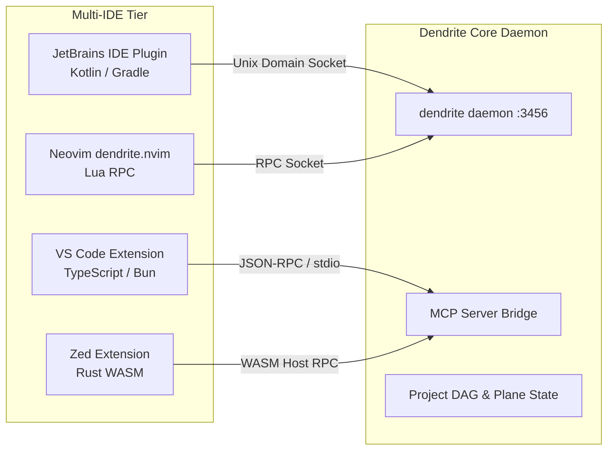

<!-- Imported from Dendrite docs/features/FEAT-046-multi-ide-plugins.md @ 69ea048 on 2026-10-18. Source of truth for this repo's scope; keep in sync with the Dendrite copy until the extraction umbrella lands. -->

# FEAT-046: Multi-IDE Plugin Suite & Interoperability Architecture

## 1. Executive Summary & Context
Developers interact with Dendrite through diverse IDE environments. FEAT-046 standardizes the architecture and implementation roadmap for:
1. **JetBrains Plugin (`dendrite-jetbrains`)**: Written in Kotlin with Gradle, supporting IntelliJ IDEA, GoLand, and RustRover. Integrates local AI chat, live project DAG status, and inline Graphify community badges.
2. **VS Code Extension (`dendrite-vscode`)**: Built using `bun` and TypeScript, embedding a native MCP client and sidebar agent chat.
3. **Neovim Client (`dendrite.nvim`)**: Headless Lua RPC client integrating with Neovim's built-in LSP and Treesitter.
4. **Zed Extension (`dendrite-zed`)**: High-performance Rust WASM extension integrating with Zed's extension host.

---

## 2. Multi-IDE Architecture & Protocol Bus



### 2.1 JetBrains Plugin Architecture
- **Language & Build**: Kotlin 2.0+, Gradle IntelliJ Plugin (`org.jetbrains.intellij.platform`).
- **Capabilities**:
  - Live socket connection to `dendrite daemon`.
  - Sidebar ToolWindow with local-first AI chat.
  - Line markers indicating ticket blockers (`[Blocked by DEN-037]`).
  - PSI tree navigation integrated with Graphify community clusters.

### 2.2 VS Code Extension Architecture
- **Language & Runtime**: TypeScript 5.5+ packaged via `bun run package`.
- **Capabilities**:
  - TreeDataProvider for active Plane tickets and milestones.
  - Native Webview sidebar chat powered by LiteLLM proxy and Ollama Metal.

---

## 3. Plane Tickets

| Ticket ID | Title | Priority | Estimate | Milestone | Start Date | Target Date | Blocked By |
|:---|:---|:---:|:---:|:---|:---:|:---:|:---|
| **DEND-301** | [JetBrains Validation]: Audit live IDE socket bridge & state detection without mocks | High | 3 SP | Milestone 10 | 2027-02-04 | 2027-02-05 | DEN-028 |
| **DEND-302** | [Plugin - JetBrains]: JetBrains Plugin (`dendrite-jetbrains`) with local AI chat & Graphify markers | Urgent | 8 SP | Milestone 10 | 2027-02-06 | 2027-02-08 | DEND-301 |
| **DEND-303** | [Plugin - VS Code]: VS Code Extension (`dendrite-vscode`) built with bun & MCP context | High | 5 SP | Milestone 10 | 2027-02-09 | 2027-02-11 | DEND-302 |
| **DEND-304** | [Plugin - Neovim]: Headless Lua RPC client (`dendrite.nvim`) | Medium | 3 SP | Milestone 10 | 2027-02-12 | 2027-02-13 | DEND-303 |
| **DEND-305** | [Plugin - Zed]: Rust WASM extension (`dendrite-zed`) | Medium | 3 SP | Milestone 10 | 2027-02-14 | 2027-02-15 | DEND-304 |

---

## 4. Grouped GitHub Validation Issues

### GitHub Issue #4: Validate Current JetBrains Interoperability & Full JetBrains AI Chat Plugin
- **Covers Plane Tickets**: `DEND-301`, `DEND-302`
- **Acceptance Criteria**:
  1. JetBrains socket bridge connects cleanly to active GoLand/RustRover instances.
  2. Sandboxed IDE instance runs with local chat tool window functional.
  3. Inline gutter markers display ticket dependencies and blocker statuses.
- **Replication & Evaluation Instructions**:
  ```bash
  # 1. Validate JetBrains socket connectivity
  dendrite jetbrains probe

  # 2. Run Gradle headless verification of plugin
  cd plugins/jetbrains && ./gradlew test --no-daemon

  # 3. Verify IDE MCP tool configuration
  dendrite jetbrains setup --project_dir .
  ```

### GitHub Issue #5: Validate VS Code Extension with MCP Context and Sidebar AI Chat
- **Covers Plane Ticket**: `DEND-303`
- **Acceptance Criteria**:
  1. Extension compiles cleanly via `bun`.
  2. Sidebar view renders active Plane tickets and responds to queries via local Ollama.
- **Replication & Evaluation Instructions**:
  ```bash
  cd plugins/vscode
  bun install --frozen-lockfile
  bun test
  ```

### GitHub Issue #6: Validate Neovim and Zed Headless Integration Specs
- **Covers Plane Tickets**: `DEND-304`, `DEND-305`
- **Replication & Evaluation Instructions**:
  ```bash
  # Test Neovim Lua plugin via headless plenary
  nvim --headless -u NONE -c "PlenaryBustedDirectory tests/neovim"
  ```
