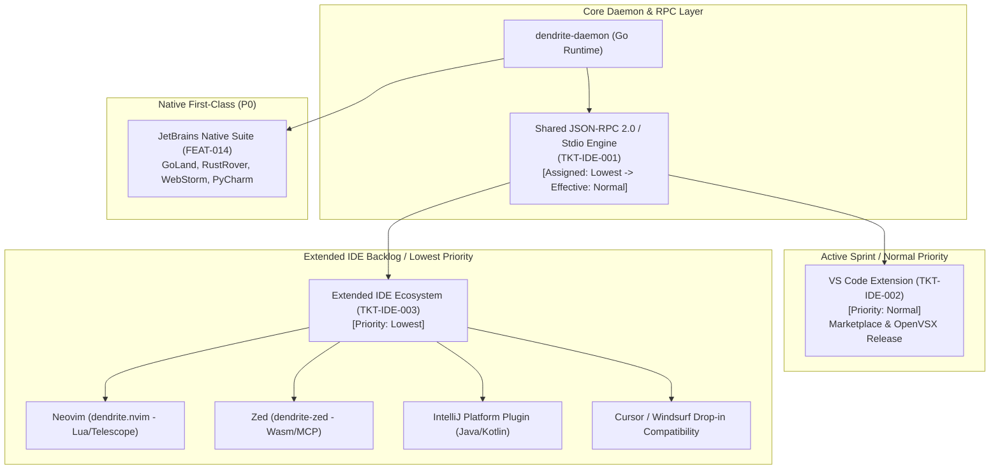

<!-- Imported from Dendrite docs/features/FEAT-100-multi-ide-ecosystem-support.md @ 69ea048 on 2026-10-18. Source of truth for this repo's scope; keep in sync with the Dendrite copy until the extraction umbrella lands. -->

---
id: FEAT-100
title: "Multi-IDE Ecosystem Support & Decoupled Architecture"
status: approved
plane_epic: PROJ-E-15
dependencies: [FEAT-014, FEAT-029]
repository: dendrite
tags: [multi-ide, vscode, jetbrains, neovim, zed, lsp, json-rpc, lowest-priority-epic]
---

# FEAT-100: Multi-IDE Ecosystem Support & Decoupled Architecture

## 1. Executive Summary & Problem Statement

### The Problem
Engineers working on multi-repository and polyglot codebases use varied development environments. While JetBrains IDEs (GoLand, RustRover, WebStorm, PyCharm) have first-class native support in Dendrite (`FEAT-014`), developers using VS Code, Cursor, Windsurf, Neovim, or Zed require integrated pool management, DAG visualization, and ticket context. 

However, building distinct, full-featured plugins for multiple IDEs simultaneously risks derailing the core product roadmap with massive UI maintenance overhead. If multi-IDE support is treated as a monolithic, high-priority deliverable, it diverts engineering resources from core autonomous orchestration, token governance, and binary reverse engineering.

### User Story & Architectural Pillars
As an engineering team lead and polyglot developer, I need Dendrite to:
1. Establish a decoupled **Multi-IDE Ecosystem Architecture** where the broader epic is assigned `Lowest` default priority, ensuring it does not bloat active releases.
2. Elevate the **VS Code Extension (`TKT-IDE-002`)** to `Normal` priority as the primary secondary editor target.
3. Decouple all IDE adapters from core business logic via a shared, platform-agnostic **Core JSON-RPC Engine (`TKT-IDE-001`)** whose effective priority is automatically elevated from `Lowest` to `Normal` via dependency propagation.
4. Maintain lightweight, community-ready adapters for Neovim, Zed, Cursor, and extended JetBrains IDEs (`TKT-IDE-003`) strictly at `Lowest` priority in the backlog.

---

## 2. Priority Governance & Bottom-Up Elevation Matrix

The Multi-IDE feature hierarchy enforces strict priority inheritance:
- **Default Epic Priority**: `Lowest`.
- **Child Ticket Inheritance Rule**: Sibling tickets inherit `Lowest` priority unless explicitly elevated.
- **Dependency Propagation Rule**: Foundational blocker modules inherit the highest priority of their downstream consumers:
  $$\text{Priority}_{\text{effective}}(\texttt{TKT-IDE-001}) = \max(\text{Lowest}, \text{Priority}_{\text{effective}}(\texttt{TKT-IDE-002})) = \text{Normal}$$

| Ticket ID | Component / Deliverable | Assigned Priority | Effective Priority | Target Milestone | Rationale |
|:---|:---|:---:|:---:|:---|:---|
| **`TKT-IDE-001`** | Shared Core Engine & JSON-RPC Client | `Lowest` | **`Normal`** | Milestone 1 (Foundation & VS Code MVP) | Blocker for `TKT-IDE-002` |
| **`TKT-IDE-002`** | VS Code Extension (MVP & Marketplace) | `Normal` | **`Normal`** | Milestone 1 (Foundation & VS Code MVP) | Explicit priority elevation |
| **`TKT-IDE-003`** | Extended Backlog (Neovim, Zed, IntelliJ) | `Lowest` | **`Lowest`** | Milestone 3 (Extended IDE Backlog) | Deferred to protect sprint scope |

---

## 3. Detailed User Stories & Tickets

### `TKT-IDE-001` (`TKT-101`): Shared Core Engine & LSP/API Client
- **User Story**: As a platform maintainer, I want a headless, platform-agnostic core client handling authentication, state synchronization, and pool DAG communication so that all IDE adapters share a single source of truth for business logic.
- **Acceptance Criteria**:
  - [ ] Core communication layer operates independently of any IDE UI runtime or DOM API.
  - [ ] Standardized JSON-RPC 2.0 interface exposed over stdio and Unix domain sockets (`~/.dendrite/dendrite.sock`).
  - [ ] Shared client library with serialization bindings for Go, TypeScript, and Lua.
  - [ ] Unit test coverage reaches $\ge 85\%$ on core request/response handlers with zero memory leaks.

### `TKT-IDE-002` (`TKT-102`): VS Code Extension (MVP & Marketplace Release)
- **User Story**: As a VS Code user, I want to install and configure Dendrite directly from the VS Code Marketplace and OpenVSX so I can manage pools, execute stories, and view DAGs without leaving my editor.
- **Acceptance Criteria**:
  - [ ] Command Palette commands registered (`Dendrite: Pool Status`, `Dendrite: Stories Next`, `Dendrite: Switch Mode`).
  - [ ] Status Bar item showing active AI tier (Ollama Metal vs. Cloud Gemini/Copilot) and Turso cache status.
  - [ ] Sidebar Webview rendering interactive Pool DAG and active story acceptance criteria.
  - [ ] Secure token storage integrated via VS Code `SecretStorage` API.
  - [ ] Automated CI/CD packaging and publishing via `vsce` to Visual Studio Marketplace and OpenVSX.

### `TKT-IDE-003` (`TKT-103`): Popular IDEs Backlog Adapters (IntelliJ, Neovim, Zed)
- **User Story**: As an engineer using lightweight or non-VS Code editors, I want thin adapters for Neovim, Zed, and IntelliJ so I have consistent pool access across my preferred editor.
- **Acceptance Criteria**:
  - [ ] `dendrite.nvim`: Lightweight Lua plugin wrapping stdio JSON-RPC with Telescope pickers for pool members and ticket switching.
  - [ ] `dendrite-zed`: WebAssembly extension + MCP bridge integration for Zed editor.
  - [ ] IntelliJ Platform plugin wrapping shared core client targeting current IntelliJ Platform SDK versions.
  - [ ] Cursor / Windsurf drop-in compatibility verified using packaged VSIX without proprietary Microsoft marketplace dependencies.

---

## 4. Behavioral Scenarios (Gherkin)

### Scenario IDE-1A: VS Code Extension Installation & Status Bar Hook
- **Given** a developer installs `dendrite-vscode` from the VS Code Marketplace
- **When** the developer opens a multi-directory workspace managed by `dendrite pool`
- **Then** the extension connects to the shared JSON-RPC engine, populates the status bar with current AI execution tier and Turso offline cache state, and renders the Pool DAG panel in the sidebar.

### Scenario IDE-1B: Effective Priority Elevation for Shared Core Engine
- **Given** Epic `FEAT-100` is initialized with default priority `Lowest`
- **When** the DAG connector evaluates the dependency between `TKT-IDE-002` (VS Code, Priority `Normal`) and `TKT-IDE-001` (Core Engine, Priority `Lowest`)
- **Then** `TKT-IDE-001`'s effective priority is elevated to `Normal` and scheduled in Milestone 1, while sibling tickets under `TKT-IDE-003` remain at `Lowest` in Milestone 3.

### Scenario IDE-1C: Neovim Telescope Pool Picker Execution
- **Given** a developer has `dendrite.nvim` installed in Neovim
- **When** the user executes `:Telescope dendrite pool`
- **Then** Neovim queries the daemon via stdio JSON-RPC, displays the list of pool members with their current dependency modes (`published`, `branch`, `local`, `fork`), and allows switching modes interactively.

---

## 5. Acceptance Criteria & Definition of Done

- [ ] **AC-1 (Decoupled Core Client)**: Platform-agnostic JSON-RPC client implemented with stdio/socket transport.
- [ ] **AC-2 (VS Code Extension MVP)**: Command palette, status bar, sidebar Webview, and `SecretStorage` integration.
- [ ] **AC-3 (Priority Decoupling & Propagation)**: Default `Lowest` epic priority preserved while elevating `TKT-IDE-001` and `TKT-IDE-002` to `Normal`.
- [ ] **AC-4 (Extended IDE Adapters)**: Thin client specifications for Neovim (Lua), Zed (Wasm), and IntelliJ Platform.
- [ ] **AC-5 (DoD & Complexity Thresholds)**: Comprehensive unit tests for RPC handlers; cyclomatic complexity $\le 15$; cognitive complexity $\le 20$; test coverage $\ge 85\%$.
