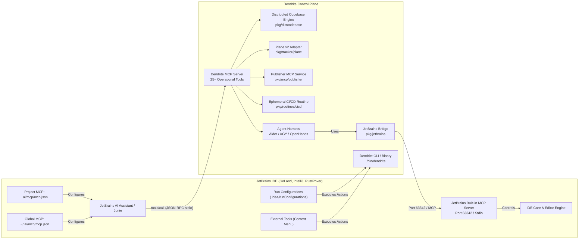

<!-- Imported from Dendrite docs/guides/jetbrains-mcp-and-agents-setup.md @ 69ea048 on 2026-10-18. Source of truth for this repo's scope; keep in sync with the Dendrite copy until the extraction umbrella lands. -->

---
id: jetbrains-mcp-and-agents-setup
title: "JetBrains IDE MCP & Autonomous Agent Integration Guide"
sidebar_label: "JetBrains MCP & Agents Setup"
sidebar_position: 3
tags: [jetbrains, mcp, agents, goland, publisher, cicd, ephemeral]
---

# JetBrains IDE MCP & Autonomous Agent Integration Guide

## 1. Overview & Architecture

Dendrite provides bidirectional integration with the **JetBrains IDE Ecosystem** (GoLand, IntelliJ IDEA, PyCharm, RustRover, WebStorm, CLion) through two complementary communication channels:

1. **JetBrains Native MCP Client (IDE $\to$ Dendrite)**:
   JetBrains IDEs (2024.3+, 2025+, 2026+) natively support the **Model Context Protocol (MCP 2024-11-05)**. By configuring Dendrite's native MCP server (`bin/dendrite mcp serve`), JetBrains AI Assistant, Junie, and embedded agents gain direct access to Dendrite's **25+ operational MCP tools** (ticket tracking, multi-engine inference probing, topology advisor, agent runners, distributed codebase registry, modular decomposition, cross-project interop, satellite project spawning, environment replication, telemetry, **artifact/crate publishing**, and **ephemeral local/mesh CI/CD routines**).

2. **Dendrite JetBrains Bridge (Dendrite $\to$ IDE)**:
   Through `pkg/jetbrains` and `dendrite jetbrains <probe|open|problems|symbols|build|run|setup>`, Dendrite's autonomous agents can reach back into the running JetBrains IDE over the IDE's built-in MCP server / port `63342` to navigate active editor tabs, trigger background compilations, query PSI symbols, and extract live compiler diagnostics.



---

## 2. Automated Routine: `dendrite jetbrains setup`

Dendrite includes an automated routine to configure all necessary JetBrains files in one command:

```bash
# Full automated setup (project MCP, global MCP, run configurations, external tools)
./bin/dendrite jetbrains setup

# Target only the current project (.ai/mcp/mcp.json and .idea/)
./bin/dendrite jetbrains setup --project-only

# Target only global user settings (~/.ai/mcp/mcp.json)
./bin/dendrite jetbrains setup --global-only
```

Alternatively, this routine can be triggered dynamically from any AI agent via the MCP tool `dendrite_jetbrains_setup`:

```bash
./bin/dendrite mcp call dendrite_jetbrains_setup '{"project_only": true}'
```

### What the Routine Configures:
1. **`.ai/mcp/mcp.json` (Project Root)**: Registers `dendrite` as an active project MCP server.
2. **`~/.ai/mcp/mcp.json` (User Home)**: Registers `dendrite` as a globally available MCP server across all installed JetBrains IDEs.
3. **`.idea/runConfigurations/`**: Generates ready-to-run GoLand / IntelliJ configurations:
   - `Dendrite_MCP_Server.xml` (`dendrite mcp serve`)
   - `Dendrite_Agent_Aider.xml` (`dendrite agent run aider --ticket DEN-036`)
   - `Dendrite_Agent_Antigravity.xml` (`dendrite agent run agy`)
   - `Dendrite_Web_UI.xml` (`dendrite ui --port 3456`)
   - `Dendrite_Doctor.xml` (`dendrite doctor`)
   - `Dendrite_JetBrains_Probe.xml` (`dendrite jetbrains probe`)
   - `Dendrite_Publisher_Preflight.xml` (`dendrite publish preflight`)
   - `Dendrite_CICD_Run_Local.xml` (`dendrite cicd run --target local`)
4. **`.idea/tools/External_Tools.xml`**: Adds context-menu IDE external tools:
   - `Dendrite: Run Aider on Active File`
   - `Dendrite: Run Antigravity on Active File`
   - `Dendrite: Probe MCP Diagnostics`
   - `Dendrite: List Registered MCP Tools`
   - `Dendrite: Telemetry Snapshot`
   - `Dendrite: Preflight Package Publish`
   - `Dendrite: Run Ephemeral CI/CD Pipeline`

---

## 3. Manual Configuration in JetBrains

If you prefer to configure JetBrains manually or verify your IDE settings, follow these methods:

### Method A: Configuration via `.ai/mcp/mcp.json` (Recommended)

JetBrains IDEs automatically detect MCP configuration files matching standard MCP JSON schemas:
- **Project Scope**: `<project-root>/.ai/mcp/mcp.json`
- **Global Scope**: `~/.ai/mcp/mcp.json`

Add the following configuration:

```json
{
  "mcpServers": {
    "dendrite": {
      "command": "/Users/yasuomaidana/GoLandProjects/Dendrite/bin/dendrite",
      "args": [
        "mcp",
        "serve"
      ],
      "env": {
        "DENDRITE_WORKSPACE": "/Users/yasuomaidana/GoLandProjects/Dendrite",
        "DENDRITE_ENV": "development",
        "PLANE_API_KEY": "plane_sec_dendrite_token_12345",
        "PLANE_URL": "http://localhost:8090"
      }
    }
  }
}
```

Once saved, JetBrains's `McpProjectServerConfigurationService` reloads the file via VFS listeners without requiring an IDE restart.

---

### Method B: Configuration via JetBrains IDE GUI

1. Open **Settings / Preferences** (`Cmd + ,` on macOS, `Ctrl + Alt + S` on Linux/Windows).
2. Navigate to **Tools $\to$ Model Context Protocol (MCP)** or **AI Assistant $\to$ Model Context Protocol (MCP)**.
3. Click the **`+` (Add)** icon and select **Command (stdio)**.
4. Fill in the fields:
   - **Name**: `dendrite`
   - **Command**: `/Users/yasuomaidana/GoLandProjects/Dendrite/bin/dendrite`
   - **Arguments**: `mcp serve`
   - **Environment Variables**:
     - `DENDRITE_WORKSPACE`: `/Users/yasuomaidana/GoLandProjects/Dendrite`
     - `DENDRITE_ENV`: `development`
     - `PLANE_API_KEY`: `plane_sec_dendrite_token_12345`
     - `PLANE_URL`: `http://localhost:8090`
5. Click **Apply** and **OK**.
6. The IDE status bar MCP widget will display `dendrite (25+ tools connected)`.

---

## 4. Comprehensive Catalog of Dendrite's Native MCP Tools

| Tool Identifier | Description & Capability | Primary Input Parameters |
|:---|:---|:---|
| `dendrite_ticket_list` | Query active tickets from Plane v2 with status, priority, and milestone. | `{}` |
| `dendrite_ticket_update` | Mutate ticket state (e.g. Backlog $\to$ Todo $\to$ In Progress $\to$ Done). | `ticket_id`, `status` |
| `dendrite_plane_issues` | Comprehensive Plane v2 issue search with filter criteria. | `project_id`, `state` |
| `dendrite_plane_push_status`| Bulk push and reconcile status ledgers to Plane v2. | `file_path`, `dry_run` |
| `dendrite_plane_doc_sync` | Synchronize markdown docs into Plane project documentation pages. | `docs_dir`, `project_id`|
| `dendrite_plane_replicate` | Replicate Plane v2 project structure, states, and modules to target. | `target_project_name` |
| `dendrite_dist_sources` | **Priority-tiered multi-source registry** ($P_1$: Own, $P_2$: Curated OSS, $P_3$: Registries). | `query`, `min_priority` |
| `dendrite_dist_decompose` | **Scenario 1**: Force modular decomposition and search ecosystem reuse. | `target`, `user_requested_custom` |
| `dendrite_dist_interop` | **Scenario 3**: Local LLM cross-project interop coordinator (fallback & TODO). | `source_project`, `target_project`, `action` |
| `dendrite_dist_spawn` | **Scenario 2 & 4**: Parallel repository spawner & Plane v2 project creator. | `project_name`, `language`, `create_plane_project` |
| `dendrite_agent_run` | Dispatch autonomous coding loop (Aider, OpenHands, OpenCode, AGY). | `agent_type`, `ticket_id`, `task` |
| `dendrite_telemetry` | Real-time Apple Silicon SoC thermals and LiteLLM spend window totals. | `{}` |
| `dendrite_jetbrains_setup`| Auto-configure JetBrains MCP server, Run Configurations, and Tools. | `project_only`, `global_only` |
| `dendrite_ollama_probe` | Probe local Ollama Metal GPU instance, check models and local latency. | `{}` |
| `dendrite_inference_list` | List all operational engines (Ollama, OxiLLaMa, vLLM, TGI, LiteLLM). | `{}` |
| `dendrite_inference_probe`| Health-check and sample TTFT/TPS latency on target engine. | `engine_type` |
| `dendrite_topology_advisor`| Recommend hardware placement topologies for target scenario. | `scenario` |
| `dendrite_gateway_render` | Dynamically render LiteLLM gateway routing configurations. | `template_path` |
| `dendrite_env_status` | Pre-flight diagnostics for Docker, Go, Git, Plane, and environment. | `{}` |
| **`publisher_detect_targets`** | **FEAT-042**: Scans workspace and lists publishable packages, versions, and registries. | `workspace_path` |
| **`publisher_preflight`** | **FEAT-042**: Runs Git worktree clean check, Cargo.toml completeness, SemVer collision, and dry-run. | `workspace_path`, `package_name`, `allow_dirty` |
| **`publisher_execute`** | **FEAT-042**: Performs secret-isolated live publish with human approval gate and git tagging. | `workspace_path`, `package_name`, `approved`, `dry_run` |
| **`cicd_status`** | **FEAT-043**: Returns CI/CD routine enable status, backend, active host, and running jobs. | `{}` |
| **`cicd_enable`** | **FEAT-043**: Dynamically toggles CI/CD routine on/off with ephemeral and auto-disable overrides. | `enabled`, `ephemeral`, `auto_disable` |
| **`cicd_run_pipeline`** | **FEAT-043**: Executes disposable ephemeral container pipeline locally or over Tailscale mesh. | `repo_path`, `commit`, `steps`, `image`, `target` |

---

## 5. Technical Workflows: Distributed Codebase & Delivery Scenarios in JetBrains

JetBrains AI Assistant or Junie can execute complex distributed codebase tasks through conversational prompts:

### Scenario 1: Modular REA Decomposition & Ecosystem Reuse
Monolithic legacy targets are automatically divided into reusable sub-modules. The tool checks registered priority sources before authoring custom code:
- **Prompt in JetBrains AI Chat**:
  > *"Decompose the monolithic target 'game-renderer' into modular sub-packages and find existing libraries using `dendrite_dist_decompose`."*
- **MCP Call Triggered**:
  ```json
  {
    "tool": "dendrite_dist_decompose",
    "arguments": {
      "target": "game-renderer",
      "user_requested_custom": false
    }
  }
  ```
- **Result**: Core rendering is mapped to Priority 2 `wgpu`, data queries to Priority 2 `diesel-cte-ext`, and edge storage to `turso`. Custom development is only scheduled for unique game state logic.

---

### Scenario 2: Parallel Multi-Project & Repository Spawning
Scaffold independent repositories concurrently with language manifests and git initialization:
- **Prompt in JetBrains AI Chat**:
  > *"Spawn a new Rust project named 'sensor-stream-rs' with full Git initialization using `dendrite_dist_spawn`."*
- **MCP Call Triggered**:
  ```json
  {
    "tool": "dendrite_dist_spawn",
    "arguments": {
      "project_name": "sensor-stream-rs",
      "language": "rust",
      "create_plane_project": false
    }
  }
  ```

---

### Scenario 3: Cross-Project Interoperability Coordinator (Docula $\to$ Oxipix)
When working on `Docula` which depends on user-owned `Oxipix` and `semdag`:
1. Request a capability in `Oxipix` (e.g., `simd-blend-modes`).
2. Generate an interim fallback in `Docula` tagged with `// TODO(interop:Oxipix): Replace with Oxipix::simd_blend once implemented`.
3. Unblock `Docula` development immediately.
4. Once `Oxipix` is updated, apply reconciliation patch.
- **Prompt in JetBrains AI Chat**:
  > *"Coordinate the SIMD blend feature between Docula and Oxipix using `dendrite_dist_interop`."*
- **MCP Call Triggered**:
  ```json
  {
    "tool": "dendrite_dist_interop",
    "arguments": {
      "source_project": "Docula",
      "target_project": "Oxipix",
      "feature": "simd-blend-modes",
      "action": "request"
    }
  }
  ```

---

### Scenario 4: Generative Satellite Projects (Carla-to-Rust) & Plane Lifecycle
When executing full language translations (e.g. Carla simulator to 100% Rust), spin off missing libraries into separate Plane projects:
- **Prompt in JetBrains AI Chat**:
  > *"Create a generative satellite project for Carla sensor suite in Rust with a dedicated Plane project using `dendrite_dist_spawn`."*
- **MCP Call Triggered**:
  ```json
  {
    "tool": "dendrite_dist_spawn",
    "arguments": {
      "project_name": "carla-sensor-rs",
      "language": "rust",
      "create_plane_project": true
    }
  }
  ```
- **Result**: Provisions `carla-sensor-rs` locally with Git and creates project `carla-sensor-rs` on Plane v2 (`http://localhost:8090`).

---

### Scenario 5: Artifact Publishing with Secret-Isolated Dry-Run Gate (FEAT-042)
Before publishing library crates or packages to upstream registries:
1. Agent detects workspace targets and validates topological order.
2. Performs isolated `cargo publish --dry-run` and validates metadata without leaking credentials.
3. Prompts user for approval and triggers live publication with Git release tag.
- **Prompt in JetBrains AI Chat**:
  > *"Preflight and publish crate 'dendrite-core' to crates.io with git release tagging."*
- **MCP Call Triggered**:
  ```json
  {
    "tool": "publisher_preflight",
    "arguments": {
      "workspace_path": "/Users/yasuomaidana/GoLandProjects/Dendrite",
      "package_name": "dendrite-core"
    }
  }
  ```
- **Result**: Preflight returns structured summary (warnings: 0, size: 42 KB, dry_run: PASS). Subsequent approved call to `publisher_execute` pushes to `crates.io` and creates tag `v0.4.2`.

---

### Scenario 6: Ephemeral Local/Mesh CI/CD Verification (FEAT-043)
Offload heavy test compilation without paying for cloud runner minutes or draining local resources:
1. Agent enables ephemeral routine on demand (`cicd_enable`).
2. Runs build and test suite inside cleanroom container or over Tailscale mesh.
3. Obtains bounded error tail if broken, or pass status, and routine auto-disables.
- **Prompt in JetBrains AI Chat**:
  > *"Run the test suite ephemerally on the remote Debian builder before opening a PR."*
- **MCP Call Triggered**:
  ```json
  {
    "tool": "cicd_run_pipeline",
    "arguments": {
      "repo_path": "/Users/yasuomaidana/GoLandProjects/Dendrite",
      "commit": "HEAD",
      "steps": ["cargo clippy -- -D warnings", "cargo test --all-targets"],
      "target": "custom_server"
    }
  }
  ```
- **Result**: Offloads compilation to `ssh://dendrite@100.64.0.12`, streams truncated diagnostics ($< 2$ KB) back to AI Assistant, and automatically cleans up the remote container.

---

## 6. How to Use Tools via JetBrains External Tools Menu

You can invoke Dendrite operations directly on the file you are actively editing:

1. Right-click anywhere in the editor code area or in the Project view.
2. Select **External Tools** $\to$ **Dendrite**:
   - **`Dendrite: Run Aider on Active File`**: Launches an autonomous pair-programming loop targeted at the active file.
   - **`Dendrite: Run Antigravity on Active File`**: Invokes the high-cognition strategic agent to inspect the current file.
   - **`Dendrite: Probe MCP Diagnostics`**: Validates stdio MCP communication and lists tool status.
   - **`Dendrite: List Registered MCP Tools`**: Displays all MCP tools with schema descriptions in the IDE Run window.
   - **`Dendrite: Telemetry Snapshot`**: Displays real-time Apple Silicon thermals and LiteLLM token usage in the IDE console.
   - **`Dendrite: Preflight Package Publish`**: Runs clean worktree, metadata, and dry-run packaging checks on the active crate.
   - **`Dendrite: Run Ephemeral CI/CD Pipeline`**: Executes an immediate disposable container pipeline on the active repository.

---

## 7. How to Use Tools via JetBrains Run Configurations

In the top-right toolbar of GoLand or IntelliJ, click the Run Configuration dropdown:

| Configuration Name | Action Performed | Shortcut |
|:---|:---|:---:|
| `Dendrite_Web_UI` | Starts embedded HTTP dashboard and WebSocket telemetry server on `http://localhost:3456`. | `Shift + F10` |
| `Dendrite_Doctor` | Runs environment diagnostics checking Docker, Ollama, Plane, LiteLLM, and Go compiler. | `Shift + F10` |
| `Dendrite_MCP_Server` | Launches Model Context Protocol stdio server for external MCP debuggers. | `Shift + F10` |
| `Dendrite_Agent_Aider` | Launches Aider autonomous coding loop bound to virtual LiteLLM keys. | `Shift + F10` |
| `Dendrite_Agent_Antigravity` | Launches Antigravity high-cognition cloud agent session. | `Shift + F10` |
| `Dendrite_JetBrains_Probe` | Probes running JetBrains IDE's MCP port `63342` and verifies IDE control tools. | `Shift + F10` |
| `Dendrite_Publisher_Preflight` | Runs isolated metadata and dry-run preflight verification for package publishing. | `Shift + F10` |
| `Dendrite_CICD_Run_Local` | Triggers immediate local ephemeral Docker pipeline with automatic `--rm` teardown. | `Shift + F10` |

---

## 8. Controlling JetBrains from Autonomous Agents (Reverse Channel)

Dendrite's autonomous coding agents (Aider, OpenHands, AGY) can leverage the running IDE's internal capabilities through `pkg/jetbrains`:

```bash
# Verify IDE connectivity from terminal
./bin/dendrite jetbrains probe

# Navigate the IDE editor to a specific file and line
./bin/dendrite jetbrains open pkg/distcodebase/registry.go 45

# Extract live IDE inspection problems and compiler errors
./bin/dendrite jetbrains problems pkg/distcodebase/registry.go

# Search project PSI symbol index for structs, interfaces, and methods
./bin/dendrite jetbrains symbols ResolveCapability

# Trigger background compilation inside the IDE
./bin/dendrite jetbrains build
```

---

## 9. Verification & Operational Health Check

To verify that your JetBrains IDE and Dendrite MCP server are operating in perfect synchrony:

```bash
# 1. Check all registered MCP tools
./bin/dendrite mcp tools

# 2. Test tool execution directly via CLI
./bin/dendrite mcp call dendrite_dist_sources '{"query":"wgpu"}'

# 3. Test publisher preflight via MCP
./bin/dendrite mcp call publisher_preflight '{"workspace_path":"."}'

# 4. Check ephemeral CI/CD routine status
./bin/dendrite mcp call cicd_status '{}'

# 5. Check Plane connectivity
./bin/dendrite plane status
```
