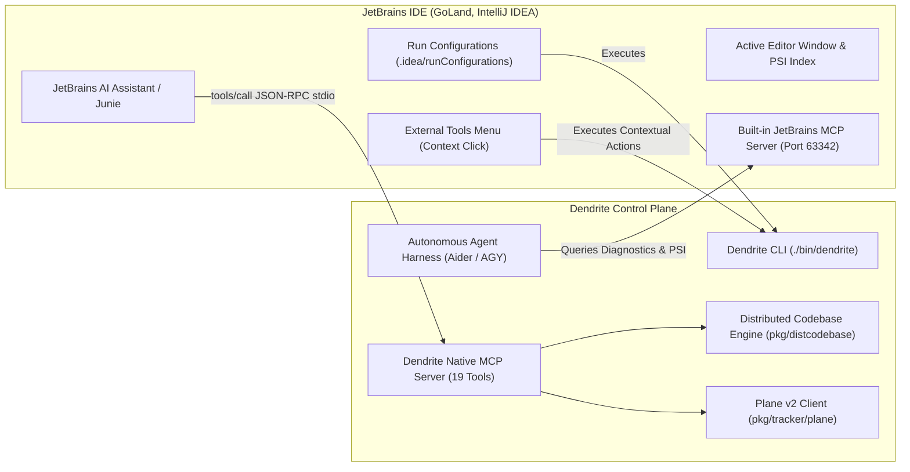

<!-- Imported from Dendrite docs/guides/using-dendrite-tools-with-jetbrains.md @ 69ea048 on 2026-10-18. Source of truth for this repo's scope; keep in sync with the Dendrite copy until the extraction umbrella lands. -->

---
id: using-dendrite-tools-with-jetbrains
title: "Using Dendrite Tools with JetBrains IDEs"
sidebar_label: "Using Tools with JetBrains"
sidebar_position: 5
tags: [jetbrains, ide, tooling, shortcuts]
---

# Using Dendrite Tools with JetBrains IDEs (GoLand, IntelliJ IDEA, PyCharm, RustRover)

## 1. Overview & Architecture

Dendrite provides seamless, bidirectional integration with the **JetBrains IDE Ecosystem** (GoLand, IntelliJ IDEA, PyCharm, RustRover, WebStorm, CLion). The integration operates across two complementary planes:

1. **JetBrains as MCP Client (IDE $\to$ Dendrite)**:
   JetBrains AI Assistant, Junie, and local assistant plugins consume Dendrite's native **Model Context Protocol (MCP 2024-11-05)** server, giving AI assistants direct access to Dendrite's 19 operational MCP tools (ticket tracking, multi-engine inference probing, topology advisor, agent runners, distributed codebase registry, and telemetry).

2. **Dendrite Agent Reverse Bridge (Dendrite $\to$ IDE)**:
   Autonomous agents running in Dendrite reach back into the active JetBrains IDE over port `63342` and the JetBrains MCP server to inspect open files, query compiler problems and inspection warnings, trigger builds, and search PSI symbols.



---

## 2. Automated One-Command Setup

To configure your JetBrains IDE to recognize all Dendrite tools, run the automated setup command from your terminal:

```bash
./bin/dendrite jetbrains setup
```

### What this command automatically generates:
1. **`.ai/mcp/mcp.json`**: Registers the Dendrite MCP server in the project scope.
2. **`~/.ai/mcp/mcp.json`**: Registers the Dendrite MCP server in your global user settings across all JetBrains IDEs.
3. **`.idea/runConfigurations/`**: Generates 6 ready-to-run configurations in the top-right toolbar:
   - `Dendrite_MCP_Server.xml`
   - `Dendrite_Agent_Aider.xml`
   - `Dendrite_Agent_Antigravity.xml`
   - `Dendrite_Web_UI.xml`
   - `Dendrite_Doctor.xml`
   - `Dendrite_JetBrains_Probe.xml`
4. **`.idea/tools/External_Tools.xml`**: Adds 5 context-menu actions under `Tools -> External Tools -> Dendrite`.

---

## 3. How to Use Tools via JetBrains AI Assistant / Junie

Once `.ai/mcp/mcp.json` is configured, open the **AI Assistant** or **Junie** tool window in JetBrains (`Cmd + E` $\to$ AI Assistant). The assistant automatically connects to the Dendrite MCP server and has access to all 19 tools.

### Example Prompts in JetBrains AI Chat:

#### A. Distributed Codebase & Priority Resolver
- *"List all registered codebase sources with their priority tiers using `dendrite_dist_sources`."*
- *"Query the distributed codebase to see if we have a library that handles CTE queries or GPU rendering using `dendrite_dist_sources`."*
- *"Decompose this project into modular sub-packages and find existing libraries using `dendrite_dist_decompose`."*

#### B. Cross-Project Interoperability
- *"We are working on Docula and need SIMD blend modes from Oxipix. Use `dendrite_dist_interop` to coordinate the feature request and generate an interim fallback with a TODO."*
- *"Reconcile the interop ticket `interop-docula-oxipix-...` using `dendrite_dist_interop` now that Oxipix is updated."*

#### C. Plane Project Management
- *"Query all active issues and milestones from Plane v2 using `dendrite_plane_issues`."*
- *"Update the status of ticket DEN-036 in Plane using `dendrite_ticket_update`."*
- *"Sync our feature documentation to Plane pages using `dendrite_plane_doc_sync`."*

#### D. Hardware & Telemetry Diagnostics
- *"Check the current SoC thermal level and 24h token spend with `dendrite_telemetry`."*
- *"Probe the local Ollama Metal instance to see available quantized models with `dendrite_ollama_probe`."*

---

## 4. How to Use Tools via JetBrains External Tools Menu

You can invoke Dendrite operations directly on the file you are actively editing:

1. Right-click anywhere in the editor code area or in the Project view.
2. Select **External Tools** $\to$ **Dendrite**:
   - **`Dendrite: Run Aider on Active File`**: Launches an autonomous pair-programming loop targeted at the active file.
   - **`Dendrite: Run Antigravity on Active File`**: Invokes the high-cognition strategic agent to inspect the current file.
   - **`Dendrite: Probe MCP Diagnostics`**: Validates stdio MCP communication and lists tool status.
   - **`Dendrite: List Registered MCP Tools`**: Displays all 19 MCP tools with schema descriptions in the IDE Run window.
   - **`Dendrite: Telemetry Snapshot`**: Displays real-time Apple Silicon thermals and LiteLLM token usage in the IDE console.

---

## 5. How to Use Tools via JetBrains Run Configurations

In the top-right toolbar of GoLand or IntelliJ, click the Run Configuration dropdown:

| Configuration Name | Action Performed | Expected Shortcut |
|:---|:---|:---:|
| `Dendrite_Web_UI` | Starts the embedded HTTP dashboard and WebSocket telemetry server on `http://localhost:3456`. | `Shift + F10` |
| `Dendrite_Doctor` | Runs environment diagnostics checking Docker, Ollama, Plane, LiteLLM, and Go compiler. | `Shift + F10` |
| `Dendrite_MCP_Server` | Launches the Model Context Protocol stdio server for external MCP debuggers. | `Shift + F10` |
| `Dendrite_Agent_Aider` | Launches the Aider autonomous coding loop bound to virtual LiteLLM keys. | `Shift + F10` |
| `Dendrite_Agent_Antigravity` | Launches the Antigravity high-cognition cloud agent session. | `Shift + F10` |
| `Dendrite_JetBrains_Probe` | Probes the running JetBrains IDE's MCP port `63342` and verifies IDE control tools. | `Shift + F10` |

---

## 6. Controlling JetBrains from Autonomous Agents (Reverse Channel)

Dendrite's autonomous coding agents (Aider, OpenHands, AGY) can leverage the running IDE's internal capabilities through `pkg/jetbrains`:

```bash
# Verify IDE connectivity from terminal
./bin/dendrite jetbrains probe

# Navigate the IDE editor to a specific file and line
./bin/dendrite jetbrains open pkg/distcodebase/registry.go 45

# Extract live IDE inspection problems and compiler errors
./bin/dendrite jetbrains problems pkg/distcodebase/registry.go

# Search project PSI symbol index for structs, interfaces, and methods
./bin/dendrite jetbrains symbols ResolveCapability

# Trigger background compilation inside the IDE
./bin/dendrite jetbrains build
```

---

## 7. Verifying Operational Status

To verify that your JetBrains IDE and Dendrite MCP server are operating in perfect synchrony:

```bash
# 1. Check all 19 MCP tools
./bin/dendrite mcp tools

# 2. Test tool execution directly via CLI
./bin/dendrite mcp call dendrite_dist_sources '{"query":"wgpu"}'

# 3. Check Plane connectivity
./bin/dendrite plane status
```
